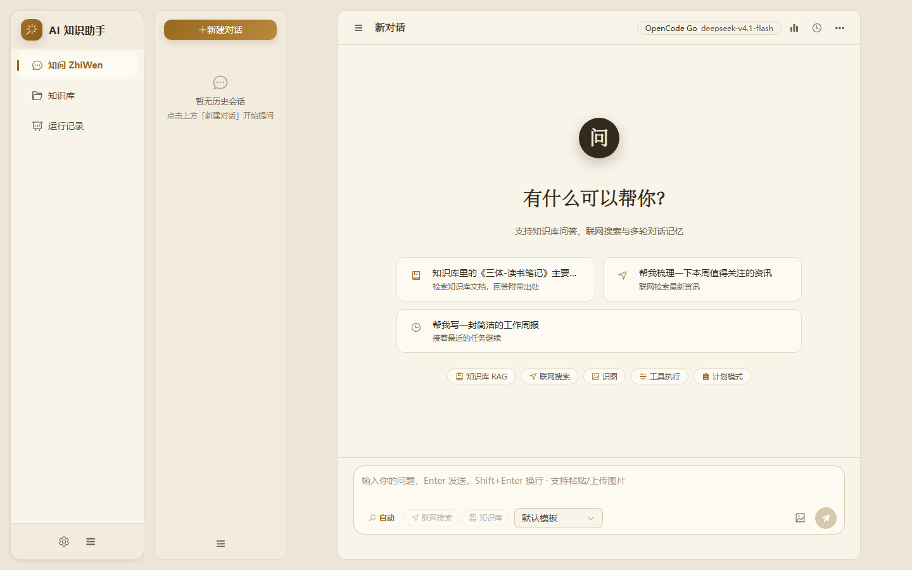
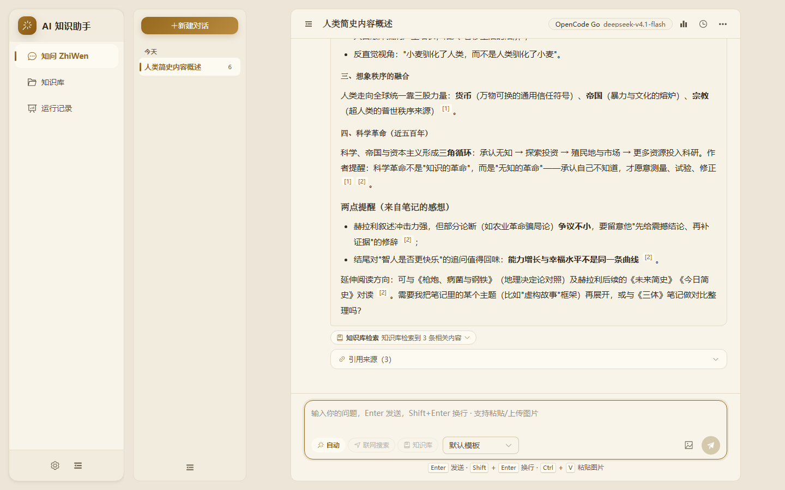
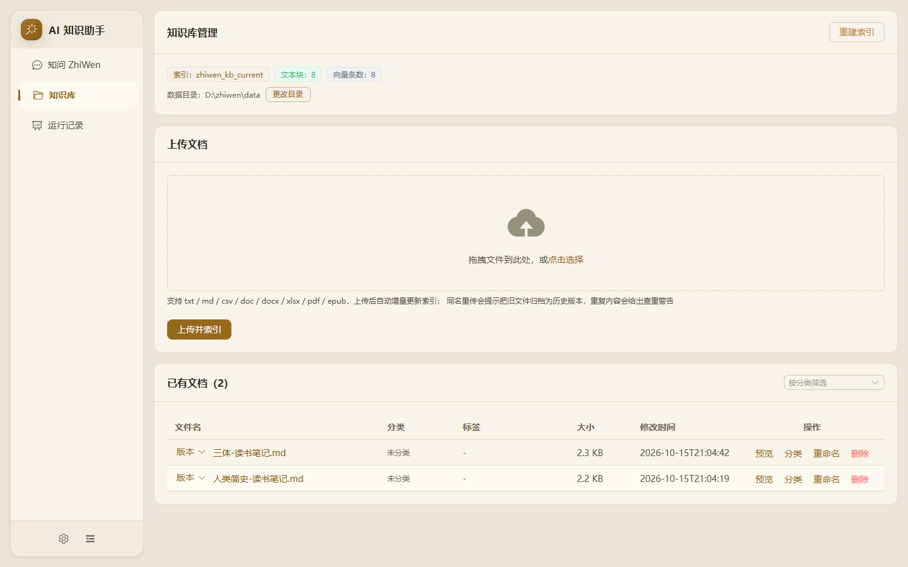
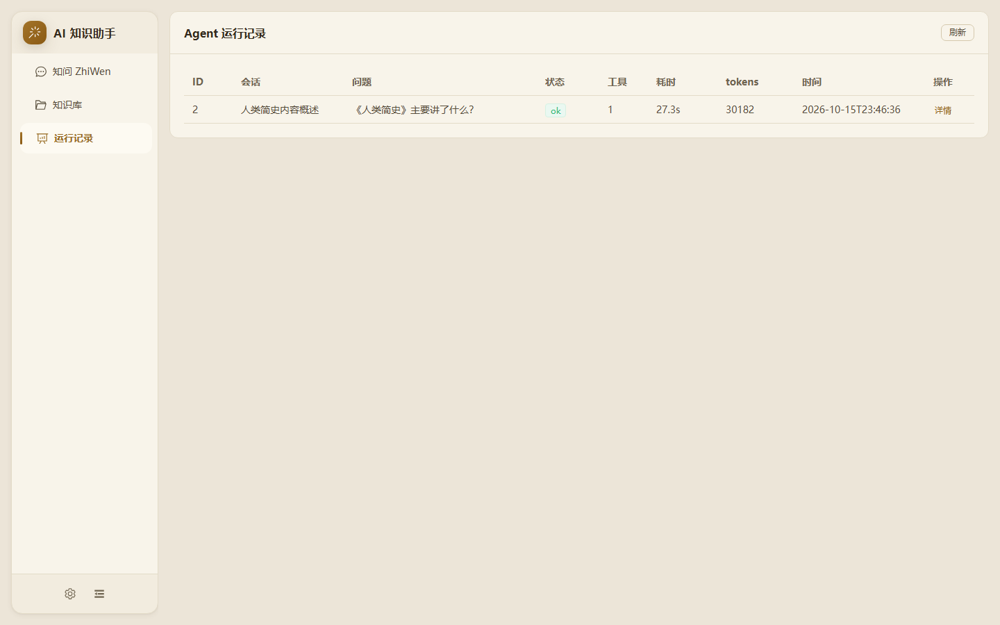
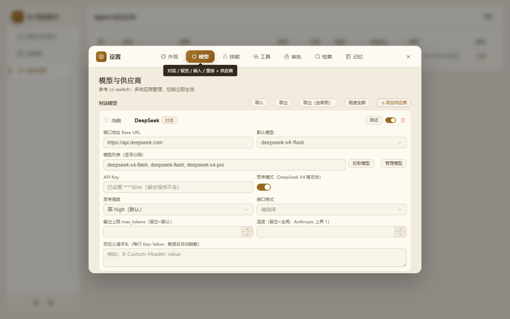

# 知问 ZhiWen · 个人知识库智能助手

<p>
  
  
  
  
  
</p>

基于 **LangChain / LangGraph** 的个人知识库 + 智能助手：把散落的本机文档（PDF / EPUB / Word / 笔记）建成可检索的私人知识库，
用带工具调用与人工确认的 Agent 回答问题——**答案带原文出处、可追溯**；
同时支持联网搜索、图片识别、本机 Skills 复用、长期记忆、代码文件与命令执行（类 Claude Code 工作流）。

- **后端**：FastAPI + LangGraph（7 节点状态图）+ OpenSearch 混合检索 + 本地 BGE Embedding/Reranker + 任意 OpenAI / Anthropic 兼容模型 + MySQL
- **前端**：Vue 3 + Element Plus（流式打字机、执行计划、审批卡片、来源引用、浅色/深色主题）
- **一键部署**：`docker compose up`（自带 OpenSearch / MySQL / SearXNG，无需本机环境）



## 核心特性

- **Agent 编排（LangGraph 状态图）**：`prepare → agent ⇄ tools → finalize`，模型自主声明并行子代理、自主进入计划模式先出方案，全程可审计
- **RAG 检索管道**：Parent-Child 切分 + Multi-Query/HyDE 查询扩展 + kNN×BM25 混合检索 + RRF 融合 + 本地 bge-reranker 精排；文件级增量索引（增改只嵌入该文件，删除秒级生效）
- **引用可追溯**：逐条来源卡片与 `[n]` 角标，点角标跳到原文；PDF / EPUB / Word 内置文档查看器
- **类 Claude Code 的文件与命令执行**：读文件/检索自动执行；写文件、执行命令走**人工确认**（原生 interrupt 挂起，批准后原轮续跑），命令可跑在 Docker 沙箱里
- **Prompt caching 友好**：消息链严格纯追加，DeepSeek 前缀缓存实测轮内命中 ~94%，长会话输入成本大幅下降
- **三层对话记忆**：MySQL 持久会话 + 滚动摘要（粘滞窗口）+ 长期事实记忆（自动提取/分类/整合/语义召回）
- **多供应商模型管理**：OpenAI 兼容与 Anthropic 兼容两种 API 格式，设置页即切即用
- **联网可信度分级**：结果自动标注 high / medium / low 并约束模型引用；DuckDuckGo → Bing → 百度 多级降级
- **终端客户端（类 Claude Code）**：`zhiwen` 一条命令进终端问答，支持审批弹窗、按目录加载 `AGENTS.md`、`/resume` 恢复会话
- **可观测性**：逐轮运行记录（用时 / token / 缓存命中 / 工具轨迹）+ JSONL trace

> 每一项的完整细节（记忆体系、HITL 流程、沙箱、键盘快捷键、全部环境变量与 API 一览）见 **[docs/GUIDE.md](docs/GUIDE.md)**。

## 界面预览

**Agent 对话** — `[n]` 引用角标、来源卡片与工具轨迹



**知识库管理** — 文档上传与增量索引状态



**运行记录** — 逐轮用时、token 用量与缓存命中



**设置** — 多供应商管理（OpenAI / Anthropic 兼容）



## 快速开始

### Docker 一键启动（推荐）

无需本机安装 Python / Node / OpenSearch / MySQL，五个服务一条命令拉起：

```bash
cp .env.example .env          # 填 DEEPSEEK_API_KEY（必填）；EMBEDDING_API_KEY 推荐填（不填无法建知识库索引）
docker compose up -d --build  # 首次构建 5~10 分钟
# 打开 http://localhost:5173 · 接口文档 http://localhost:5173/docs
```

> 本地 BGE 模型 + GPU 的 full 模式、无 N 卡的 CPU 用法、镜像分层与数据卷说明见
> [docs/GUIDE.md · Docker](docs/GUIDE.md#docker-一键启动推荐)。

### 本机开发

```powershell
# 依赖
cd backend; pip install -r requirements.txt
cd ..\frontend; npm install
# 环境变量（必填 DEEPSEEK_API_KEY；本机还需 OpenSearch 9200 / MySQL 3306）
$env:DEEPSEEK_API_KEY = "sk-..."
# 启动（或双击 start_all.bat 一键拉起全部组件）
cd backend; python run.py        # 127.0.0.1:8000
cd ..\frontend; npm run dev      # http://localhost:5173
```

详细步骤（环境要求 / 终端客户端 / 测试 / 评测）见 [docs/GUIDE.md](docs/GUIDE.md)。

## 文档

| 文档 | 内容 |
|---|---|
| [docs/GUIDE.md](docs/GUIDE.md) | **完整使用指南**：功能细节、架构设计、环境变量、API 一览、注意事项 |
| [docs/EVALUATION.md](docs/EVALUATION.md) | 评测体系（RAGAS 指标口径与实测基线） |
| [docs/INDEX_REDESIGN_PLAN.md](docs/INDEX_REDESIGN_PLAN.md) | 索引重构方案（蓝绿别名切换 / 增量账本） |
| [LICENSE](LICENSE) | MIT 许可证 |

## 许可证

本项目基于 [MIT License](LICENSE) 开源。
